<picture>
  <source media="(prefers-reduced-motion: reduce)" srcset="assets/banner-still.png">
  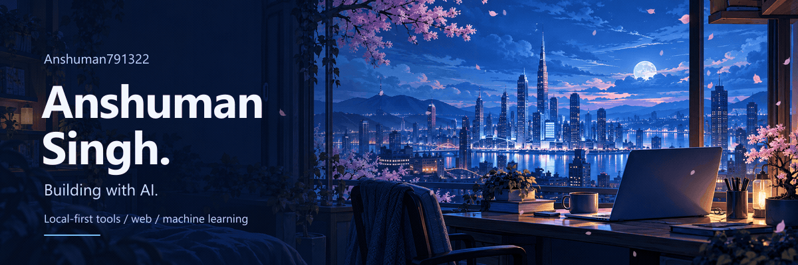
</picture>

<a href="assets/banner-still.png">View the still banner</a>

# Hi, I'm Anshuman.

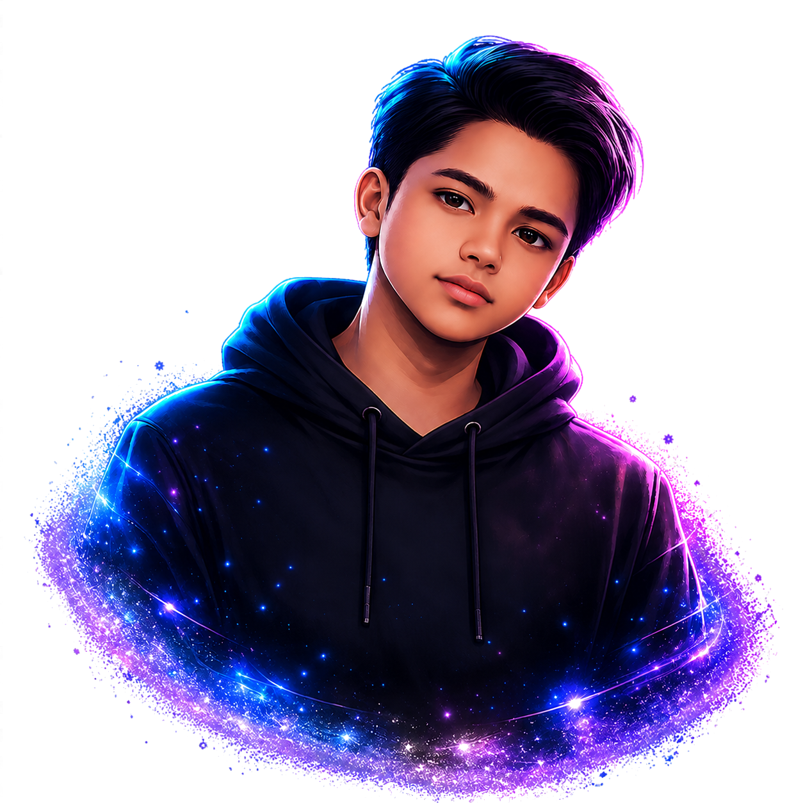

I'm a Computer Science Engineering student at Jagannath University. I build AI systems, desktop tools, and full-stack applications.

I'm currently interested in **local AI agents**, **local-first software**, and turning document and data pipelines into useful products.

  
  

 

[Project](#project) · [My toolkit](#my-toolkit) · [Activity](#activity) · [Connect](#connect)

<!-- PROJECTS:START -->
## Project

<a href="https://github.com/Lakshay-13/hunar">
  <picture>
    <source media="(prefers-reduced-motion: reduce) and (prefers-color-scheme: dark) and (max-width: 540px)" srcset="assets/projects/hunar-mobile-dark-still-rich-b095c4df.svg">
    <source media="(prefers-reduced-motion: reduce) and (prefers-color-scheme: dark)" srcset="assets/projects/hunar-dark-still-rich-fc231a33.svg">
    <source media="(prefers-reduced-motion: reduce) and (max-width: 540px)" srcset="assets/projects/hunar-mobile-still-rich-df26f991.svg">
    <source media="(prefers-reduced-motion: reduce)" srcset="assets/projects/hunar-still-rich-43f09c9e.svg">
    <source media="(prefers-color-scheme: dark) and (max-width: 540px)" srcset="assets/projects/hunar-mobile-dark-rich-ec4cb27d.svg">
    <source media="(prefers-color-scheme: dark)" srcset="assets/projects/hunar-dark-rich-d4d445f5.svg">
    <source media="(max-width: 540px)" srcset="assets/projects/hunar-mobile-rich-61f52ae4.svg">
    
  </picture>
</a>

<a href="https://github.com/Anshuman791322/aqg-studio">
  <picture>
    <source media="(prefers-reduced-motion: reduce) and (prefers-color-scheme: dark) and (max-width: 540px)" srcset="assets/projects/aqg-mobile-dark-still.svg">
    <source media="(prefers-reduced-motion: reduce) and (prefers-color-scheme: dark)" srcset="assets/projects/aqg-dark-still.svg">
    <source media="(prefers-reduced-motion: reduce) and (max-width: 540px)" srcset="assets/projects/aqg-mobile-still.svg">
    <source media="(prefers-reduced-motion: reduce)" srcset="assets/projects/aqg-still.svg">
    <source media="(prefers-color-scheme: dark) and (max-width: 540px)" srcset="assets/projects/aqg-mobile-dark.svg">
    <source media="(prefers-color-scheme: dark)" srcset="assets/projects/aqg-dark.svg">
    <source media="(max-width: 540px)" srcset="assets/projects/aqg-mobile.svg">
    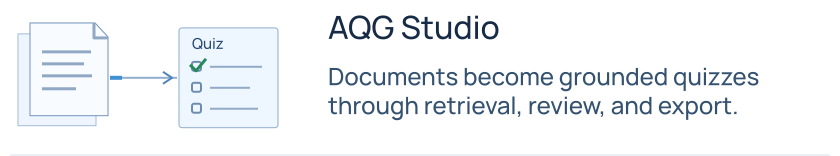
  </picture>
</a>

<a href="https://github.com/Anshuman791322/Ai-agent">
  <picture>
    <source media="(prefers-reduced-motion: reduce) and (prefers-color-scheme: dark) and (max-width: 540px)" srcset="assets/projects/jarvis-mobile-dark-still.svg">
    <source media="(prefers-reduced-motion: reduce) and (prefers-color-scheme: dark)" srcset="assets/projects/jarvis-dark-still.svg">
    <source media="(prefers-reduced-motion: reduce) and (max-width: 540px)" srcset="assets/projects/jarvis-mobile-still.svg">
    <source media="(prefers-reduced-motion: reduce)" srcset="assets/projects/jarvis-still.svg">
    <source media="(prefers-color-scheme: dark) and (max-width: 540px)" srcset="assets/projects/jarvis-mobile-dark.svg">
    <source media="(prefers-color-scheme: dark)" srcset="assets/projects/jarvis-dark.svg">
    <source media="(max-width: 540px)" srcset="assets/projects/jarvis-mobile.svg">
    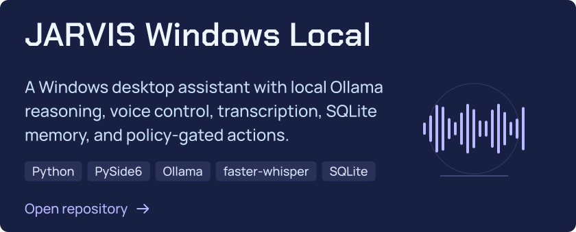
  </picture>
</a>

<a href="https://github.com/Anshuman791322/periodically-variable-stars">
  <picture>
    <source media="(prefers-reduced-motion: reduce) and (prefers-color-scheme: dark) and (max-width: 540px)" srcset="assets/projects/stars-mobile-dark-still.svg">
    <source media="(prefers-reduced-motion: reduce) and (prefers-color-scheme: dark)" srcset="assets/projects/stars-dark-still.svg">
    <source media="(prefers-reduced-motion: reduce) and (max-width: 540px)" srcset="assets/projects/stars-mobile-still.svg">
    <source media="(prefers-reduced-motion: reduce)" srcset="assets/projects/stars-still.svg">
    <source media="(prefers-color-scheme: dark) and (max-width: 540px)" srcset="assets/projects/stars-mobile-dark.svg">
    <source media="(prefers-color-scheme: dark)" srcset="assets/projects/stars-dark.svg">
    <source media="(max-width: 540px)" srcset="assets/projects/stars-mobile.svg">
    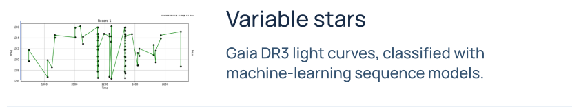
  </picture>
</a>

<a href="https://github.com/Anshuman791322/smart-driver-monitoring-dashboard-downloads">
  <picture>
    <source media="(prefers-reduced-motion: reduce) and (prefers-color-scheme: dark) and (max-width: 540px)" srcset="assets/projects/driver-mobile-dark-still.svg">
    <source media="(prefers-reduced-motion: reduce) and (prefers-color-scheme: dark)" srcset="assets/projects/driver-dark-still.svg">
    <source media="(prefers-reduced-motion: reduce) and (max-width: 540px)" srcset="assets/projects/driver-mobile-still.svg">
    <source media="(prefers-reduced-motion: reduce)" srcset="assets/projects/driver-still.svg">
    <source media="(prefers-color-scheme: dark) and (max-width: 540px)" srcset="assets/projects/driver-mobile-dark.svg">
    <source media="(prefers-color-scheme: dark)" srcset="assets/projects/driver-dark.svg">
    <source media="(max-width: 540px)" srcset="assets/projects/driver-mobile.svg">
    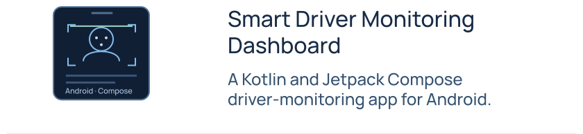
  </picture>
</a>

<a href="https://lakshay-13.github.io/zinging/">
  <picture>
    <source media="(prefers-reduced-motion: reduce) and (prefers-color-scheme: dark) and (max-width: 540px)" srcset="assets/projects/zinging-mobile-dark-still-rich-1b8ce470.svg">
    <source media="(prefers-reduced-motion: reduce) and (prefers-color-scheme: dark)" srcset="assets/projects/zinging-dark-still-rich-8aa204e6.svg">
    <source media="(prefers-reduced-motion: reduce) and (max-width: 540px)" srcset="assets/projects/zinging-mobile-still-rich-fe678a7a.svg">
    <source media="(prefers-reduced-motion: reduce)" srcset="assets/projects/zinging-still-rich-4332b179.svg">
    <source media="(prefers-color-scheme: dark) and (max-width: 540px)" srcset="assets/projects/zinging-mobile-dark-rich-aea5924a.svg">
    <source media="(prefers-color-scheme: dark)" srcset="assets/projects/zinging-dark-rich-c99b0c42.svg">
    <source media="(max-width: 540px)" srcset="assets/projects/zinging-mobile-rich-6af2019c.svg">
    
  </picture>
</a>

<a href="https://host.nextgenaischool.in">
  <picture>
    <source media="(prefers-reduced-motion: reduce) and (prefers-color-scheme: dark) and (max-width: 540px)" srcset="assets/projects/host-mobile-dark-still.svg">
    <source media="(prefers-reduced-motion: reduce) and (prefers-color-scheme: dark)" srcset="assets/projects/host-dark-still.svg">
    <source media="(prefers-reduced-motion: reduce) and (max-width: 540px)" srcset="assets/projects/host-mobile-still.svg">
    <source media="(prefers-reduced-motion: reduce)" srcset="assets/projects/host-still.svg">
    <source media="(prefers-color-scheme: dark) and (max-width: 540px)" srcset="assets/projects/host-mobile-dark.svg">
    <source media="(prefers-color-scheme: dark)" srcset="assets/projects/host-dark.svg">
    <source media="(max-width: 540px)" srcset="assets/projects/host-mobile.svg">
    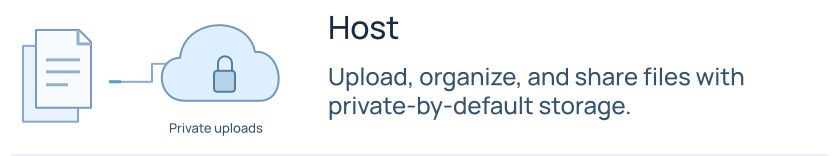
  </picture>
</a>

<a href="https://tree.nextgenaischool.in/">
  <picture>
    <source media="(prefers-reduced-motion: reduce) and (prefers-color-scheme: dark) and (max-width: 540px)" srcset="assets/projects/tree-mobile-dark-still.svg">
    <source media="(prefers-reduced-motion: reduce) and (prefers-color-scheme: dark)" srcset="assets/projects/tree-dark-still.svg">
    <source media="(prefers-reduced-motion: reduce) and (max-width: 540px)" srcset="assets/projects/tree-mobile-still.svg">
    <source media="(prefers-reduced-motion: reduce)" srcset="assets/projects/tree-still.svg">
    <source media="(prefers-color-scheme: dark) and (max-width: 540px)" srcset="assets/projects/tree-mobile-dark.svg">
    <source media="(prefers-color-scheme: dark)" srcset="assets/projects/tree-dark.svg">
    <source media="(max-width: 540px)" srcset="assets/projects/tree-mobile.svg">
    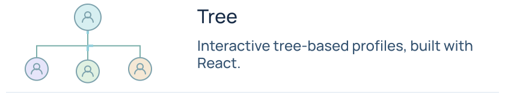
  </picture>
</a>

<a href="https://artgridx.nextgenaischool.in">
  <picture>
    <source media="(prefers-reduced-motion: reduce) and (prefers-color-scheme: dark) and (max-width: 540px)" srcset="assets/projects/artgridx-mobile-dark-still-rich-cb868747.svg">
    <source media="(prefers-reduced-motion: reduce) and (prefers-color-scheme: dark)" srcset="assets/projects/artgridx-dark-still-rich-14eed647.svg">
    <source media="(prefers-reduced-motion: reduce) and (max-width: 540px)" srcset="assets/projects/artgridx-mobile-still-rich-3695e0e2.svg">
    <source media="(prefers-reduced-motion: reduce)" srcset="assets/projects/artgridx-still-rich-3c009d43.svg">
    <source media="(prefers-color-scheme: dark) and (max-width: 540px)" srcset="assets/projects/artgridx-mobile-dark-rich-58ae3de4.svg">
    <source media="(prefers-color-scheme: dark)" srcset="assets/projects/artgridx-dark-rich-1afdce71.svg">
    <source media="(max-width: 540px)" srcset="assets/projects/artgridx-mobile-rich-c43dc5ae.svg">
    
  </picture>
</a>

<a href="https://humanify.nextgenaischool.in">
  <picture>
    <source media="(prefers-reduced-motion: reduce) and (prefers-color-scheme: dark) and (max-width: 540px)" srcset="assets/projects/humanify-mobile-dark-still-rich-5ccf0fc2.svg">
    <source media="(prefers-reduced-motion: reduce) and (prefers-color-scheme: dark)" srcset="assets/projects/humanify-dark-still-rich-3b8dd0d5.svg">
    <source media="(prefers-reduced-motion: reduce) and (max-width: 540px)" srcset="assets/projects/humanify-mobile-still-rich-347491bd.svg">
    <source media="(prefers-reduced-motion: reduce)" srcset="assets/projects/humanify-still-rich-c77a1340.svg">
    <source media="(prefers-color-scheme: dark) and (max-width: 540px)" srcset="assets/projects/humanify-mobile-dark-rich-6baaf516.svg">
    <source media="(prefers-color-scheme: dark)" srcset="assets/projects/humanify-dark-rich-21add4d5.svg">
    <source media="(max-width: 540px)" srcset="assets/projects/humanify-mobile-rich-c7a1b37b.svg">
    
  </picture>
</a>

<a href="https://anshuman791322.github.io">
  <picture>
    <source media="(prefers-reduced-motion: reduce) and (prefers-color-scheme: dark) and (max-width: 540px)" srcset="assets/projects/portfolio-mobile-dark-still.svg">
    <source media="(prefers-reduced-motion: reduce) and (prefers-color-scheme: dark)" srcset="assets/projects/portfolio-dark-still.svg">
    <source media="(prefers-reduced-motion: reduce) and (max-width: 540px)" srcset="assets/projects/portfolio-mobile-still.svg">
    <source media="(prefers-reduced-motion: reduce)" srcset="assets/projects/portfolio-still.svg">
    <source media="(prefers-color-scheme: dark) and (max-width: 540px)" srcset="assets/projects/portfolio-mobile-dark.svg">
    <source media="(prefers-color-scheme: dark)" srcset="assets/projects/portfolio-dark.svg">
    <source media="(max-width: 540px)" srcset="assets/projects/portfolio-mobile.svg">
    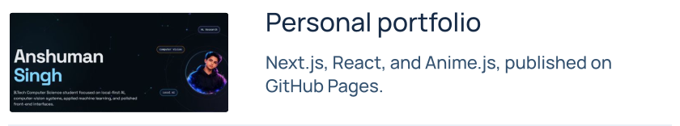
  </picture>
</a>

Full descriptions and technology stacks

### [Hunar](https://github.com/Lakshay-13/hunar)

Full-stack shopping experience for handmade gifts from independent family artisans, with catalog management, carts, secure payments, order tracking, and an operations dashboard.

`JavaScript` `CSS` `React 19` `React Router` `Bootstrap 5` `Anime.js` `Node.js` `Express 5` `PostgreSQL` `Google OAuth` `JWT` `Razorpay` `Shiprocket` `Jest` `React Testing Library`

### [AQG Studio](https://github.com/Anshuman791322/aqg-studio)

A full-stack assessment platform that turns PDF, DOCX, PPTX, and text documents into grounded quizzes. A Next.js and TypeScript frontend pairs with a FastAPI backend and LangGraph multi-agent pipeline for document parsing, pgvector-backed RAG, quality checks, human review, and exports to Moodle XML, QTI, PDF, DOCX, JSON, and CSV. Model access routes through OpenRouter with NVIDIA NIM fallback.

`Python` `FastAPI` `Pydantic` `SQLAlchemy` `LangGraph` `Next.js` `React` `TypeScript` `Tailwind CSS` `PostgreSQL` `pgvector` `Supabase` `OpenRouter` `NVIDIA NIM` `FastEmbed` `Vercel` `Render`

### [JARVIS Windows Local](https://github.com/Anshuman791322/Ai-agent)

A Windows-first desktop assistant built with PySide6. It combines local Ollama reasoning, faster-whisper transcription, SQLite memory, wake-word voice control, policy-gated actions, and a scoped Claude Code handoff. Windows builds use PyInstaller and Inno Setup.

`Python` `PySide6` `Ollama` `faster-whisper` `SQLite` `Claude Code` `PyInstaller` `Inno Setup`

### [Classifying Periodic Variable Stars](https://github.com/Anshuman791322/periodically-variable-stars)

A Gaia DR3 photometry project that classifies RR Lyrae, Cepheids, long-period variables, and eclipsing binaries. The notebook uses Pandas and NumPy for data preparation, scikit-learn for preprocessing and evaluation, and TensorFlow/Keras sequence models, with plots from Matplotlib and Seaborn.

`Python` `Jupyter Notebook` `Pandas` `NumPy` `scikit-learn` `TensorFlow/Keras` `Matplotlib` `Seaborn` `SciPy`

### [Smart Driver Monitoring Dashboard](https://github.com/Anshuman791322/smart-driver-monitoring-dashboard-downloads)

A Kotlin and Jetpack Compose driver-monitoring app published as downloadable Android APKs.

`Kotlin` `Android` `Jetpack Compose` `AndroidX Navigation Compose` `Preferences DataStore` `Kotlin Coroutines` `OkHttp` `Gson`

### [Zinging](https://lakshay-13.github.io/zinging/)

AI assistant with NVIDIA NIM-powered agent workflows, database-backed memory, caching, and translation, prepared for Railway deployment.

`Python` `NVIDIA NIM` `Featherless` `SQLAlchemy` `PostgreSQL` `SQLite` `HTTPX` `googletrans` `Unidecode` `Railway`

### [Host](https://host.nextgenaischool.in)

React and Vite file-hosting product for uploading, organizing, and sharing files through clean public links, with private-by-default uploads and moderation-aware access.

`JavaScript` `React` `Vite` `Axios` `React Router`

### [Tree](https://tree.nextgenaischool.in/)

React identity and profile platform built around interactive tree-based profile surfaces.

`JavaScript` `React`

### [ArtGridX](https://artgridx.nextgenaischool.in)

Next.js and React scrapbook-style portfolio for a drawing artist, with a masonry gallery, animated lightbox, contact form, and mobile admin dashboard.

`JavaScript` `Next.js` `React` `Lucide React` `Razorpay` `PayPal`

### [Humanify](https://humanify.nextgenaischool.in)

A JavaScript web application built with Next.js and React, backed by an authenticated API.

`JavaScript` `Next.js` `React`

### [Personal portfolio](https://anshuman791322.github.io)

A server-first portfolio built with Next.js 15, React 19, TypeScript, and Tailwind CSS v4. Anime.js powers the motion design; a static export runs on GitHub Pages.

`Next.js 15` `React 19` `TypeScript` `Tailwind CSS v4` `Anime.js` `Lucide React` `GitHub Pages`

<!-- PROJECTS:END -->

## My toolkit

<!-- AI-TOOLKIT:START -->
<picture>
  <source media="(prefers-color-scheme: dark) and (max-width: 540px)" srcset="assets/ai-icons/toolkit-mobile-dark-3c49c935.svg">
  <source media="(prefers-color-scheme: dark)" srcset="assets/ai-icons/toolkit-desktop-dark-3c49c935.svg">
  <source media="(max-width: 540px)" srcset="assets/ai-icons/toolkit-mobile-light-1a3c351a.svg">
  
</picture>
<!-- AI-TOOLKIT:END -->

<picture>
  <source media="(prefers-color-scheme: dark)" srcset="assets/toolkit-dark.svg">
  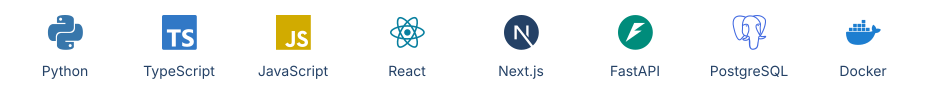
</picture>

| Area | What I use |
| :--- | :--- |
| AI assistants | Codex, Claude, Gemini, GLM, DeepSeek |
| AI and models | LangGraph, RAG, Ollama, OpenRouter, NVIDIA NIM, PyTorch, TensorFlow |
| Interfaces and APIs | Next.js, React, TypeScript, Tailwind CSS, FastAPI, PySide6, Kotlin / Compose |
| Data | PostgreSQL, pgvector, Supabase, SQLite, SQLAlchemy, Pandas, NumPy |
| Delivery | Git, GitHub Actions, Docker, Vercel, Render, Railway, GitHub Pages |

Full technology list

I build applied AI and full-stack software, from document parsing and RAG pipelines to local model inference, APIs, and web and desktop interfaces.

**Languages**

   

**AI and machine learning**

         

**Applications and APIs**

         

**Libraries and integrations**

  

**Data and storage**

          

**Development and delivery**

         

## Activity

<picture>
  <source media="(prefers-color-scheme: dark)" srcset="assets/activity-dark.svg">
  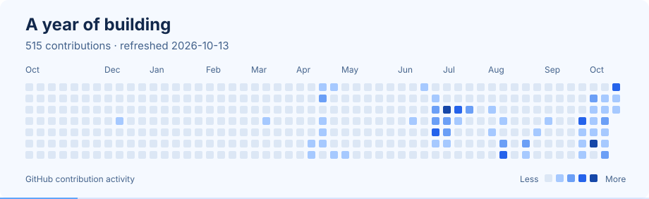
</picture>

Recent public pull requests

<!-- ACTIVITY:START -->
- [\[WIP\] Fix failing GitHub Actions job for backend lint, typecheck and tests](https://github.com/Anshuman791322/aqg-studio/pull/2) · `Anshuman791322/aqg-studio` · Open
- [Resolve backend CI failure by normalizing Ruff import blocks in export/report paths](https://github.com/Anshuman791322/aqg-studio/pull/1) · `Anshuman791322/aqg-studio` · Open
- [\[codex\] Add secure Gemini provider and key UI](https://github.com/Anshuman791322/Ai-agent/pull/1) · `Anshuman791322/Ai-agent` · Open

Updated 2026-10-13 · refreshed daily by GitHub Actions.
<!-- ACTIVITY:END -->

## Education

**Bachelor of Technology, Computer Science Engineering** 
Jagannath University · September 2023 to July 2027

## Connect

[Portfolio](https://anshuman791322.github.io) · [Anshuman6062@gmail.com](mailto:Anshuman6062@gmail.com) · [GitHub](https://github.com/Anshuman791322)
